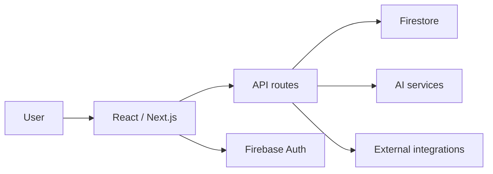

# Archii | Project case study / Caso de estudio

[Application / Aplicación](https://archii-theta.vercel.app) · [Technical documentation / Documentación técnica](README.md)

## English

Archii addresses fragmented construction project management by bringing schedules, tasks, budgets and collaboration into a single application. The documented product includes AI-assisted workflows, project-context retrieval (RAG), multi-tenant workspaces and external integrations.

### Architecture

Conceptual diagram based on repository documentation, not an audited deployment topology.

The current package manifest specifies Next.js 15.5.26, React 19, TypeScript, Firebase Admin, Vitest and Playwright. The README's Next.js 16 reference needs reconciliation.

### Evaluation
Use a dedicated Firebase test project and the configuration instructions in the README. With Node.js 22 and dependencies installed using `npm install`, run `npm run dev`, `npm run build` and `npm run test -- --run`. Inventory-specific test commands are also defined in package.json.

Suggested demo: create a test workspace, create a project and task, inspect the budget workflow, then demonstrate an AI-assisted action with synthetic data. Verify tenant isolation with two test accounts.

## Español

Archii busca centralizar la gestión de proyectos de construcción: cronogramas, tareas, presupuestos y colaboración. La documentación describe flujos asistidos por IA, recuperación de contexto (RAG), espacios multi-tenant e integraciones externas.

La arquitectura conceptual combina React y Next.js, rutas API, autenticación Firebase, Firestore y servicios externos. El manifiesto actual declara Next.js 15.5.26, React 19, TypeScript, Firebase Admin, Vitest y Playwright.

Para evaluar el proyecto, utiliza un entorno Firebase de pruebas y sigue la configuración del README. Ejecuta los comandos de desarrollo, compilación y pruebas indicados arriba.

Demostración propuesta: crear un espacio de pruebas, un proyecto y una tarea; revisar el presupuesto y mostrar una acción asistida por IA con datos ficticios. Comprobar el aislamiento entre espacios con dos cuentas de prueba.

## Evidence status / Estado de evidencia

- Repository documentation and package manifest reviewed / Documentación y manifiesto revisados.
- Live demo, build, tests, screenshots and security behavior not independently verified in this review / Demo, compilación, pruebas, capturas y seguridad pendientes de verificación independiente.
- No claims about customer counts, performance or business outcomes / Sin afirmaciones sobre clientes, rendimiento o resultados comerciales.
